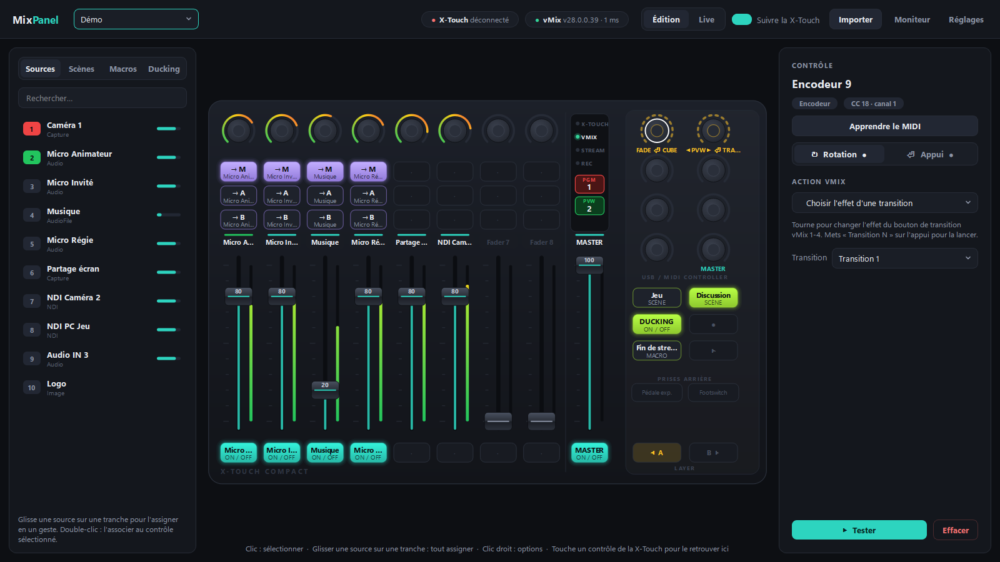
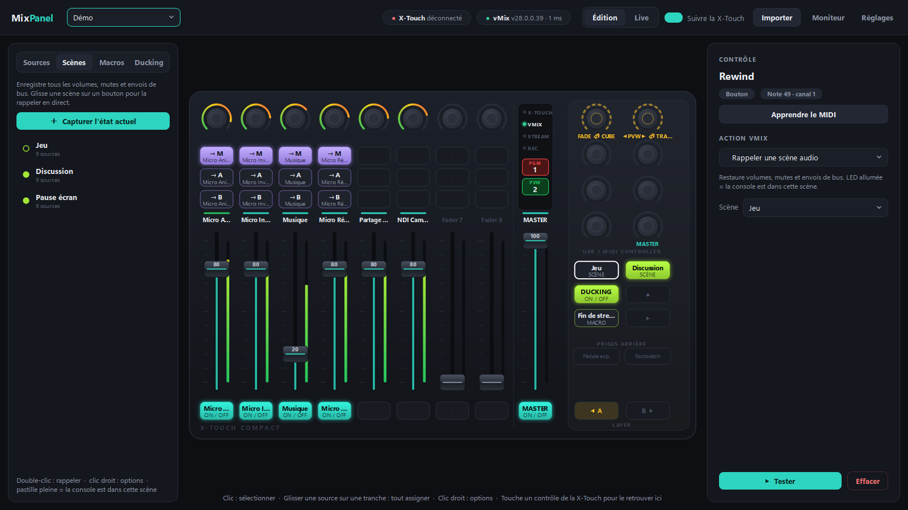
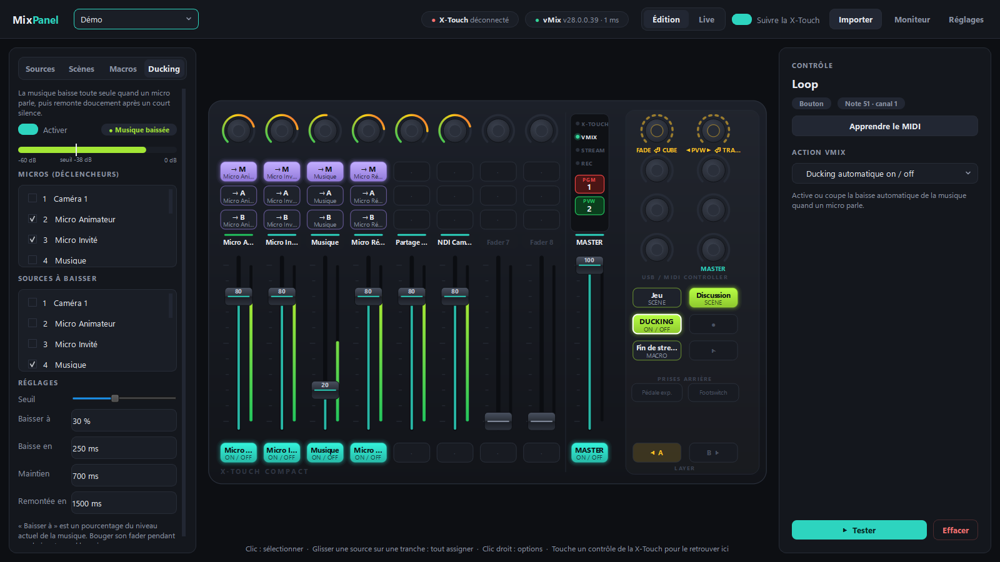
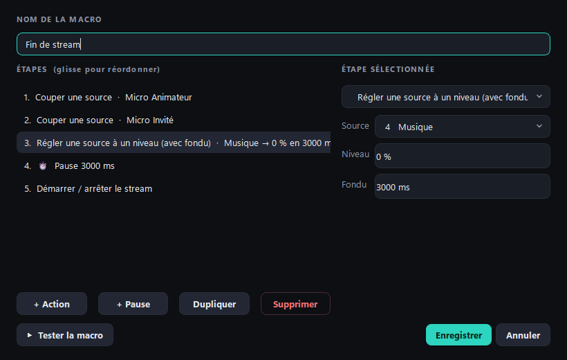

<div align="center">

# 🎚️ MixPanel

**Pilote vMix avec une Behringer X-Touch Compact, simplement.**

Une alternative légère à Central Control : une seule fenêtre, une surface à l'image de ta console,
et des associations qui se font en un geste.




</div>

---

## Pourquoi MixPanel ?

Avec Central Control, associer un fader à une source vMix demandait une demi-douzaine d'étapes.
Avec MixPanel :

1. **Tu touches** un fader ou un bouton de la X-Touch, et il se sélectionne à l'écran.
2. **Tu choisis** l'action dans le panneau de droite (la source est déjà pré-remplie).
3. **C'est tout** : pas de bouton « Enregistrer », la sauvegarde est automatique.

Mieux encore : **glisse une source vMix sur une tranche** et tout est câblé d'un coup (volume, on/off,
envois Master / A / B).

## Fonctionnalités

| | |
|---|---|
| 🎛️ **Surface fidèle** | Réplique interactive de la X-Touch Compact : LED, faders motorisés, anneaux, tally PGM/PVW et vu-mètres en direct. |
| ⚡ **Sans latence** | Les mouvements de fader sont fusionnés, donc seule la dernière valeur part vers vMix. La latence s'affiche dans l'en-tête. |
| 🔁 **Retours fiables** | LED et moteurs synchronisés avec vMix. Les faders ne luttent pas contre ta main grâce au capteur tactile. |
| 🎚️ **Encodeurs à double fonction** | La rotation et l'appui ont chacun leur action : balance, gain, navigation de la preview, choix de l'effet de transition… |
| 🎬 **Scènes audio** | Capture volumes, mutes et envois de bus, puis rappel en un bouton, avec fondu optionnel. La LED indique la scène active. |
| 🧩 **Macros** | Plusieurs actions et pauses sur un seul bouton, par exemple pour une « Fin de stream ». |
| 🎙️ **Ducking automatique** | La musique baisse quand un micro parle, puis remonte en douceur. Tout est réglable, et désactivé par défaut. |
| 💡 **Anneaux vu-mètre** | Les anneaux LED des encodeurs peuvent afficher le niveau audio d'une source, d'un bus ou du master. |
| 📑 **Pages A / B** | Les boutons LAYER de la console donnent 16 tranches : chaque page a ses propres associations, l'app suit la console toute seule. |
| 🩺 **Diagnostic** | Un assistant vérifie en une minute les LED, anneaux et moteurs, puis chaque bouton, fader et encodeur. |
| 🔌 **Plug & play** | Reconnexion automatique de la X-Touch et de vMix. Une source recréée dans vMix est retrouvée par son nom. |
| 📥 **Import Central Control** | Tes shows `.ctrl` sont convertis en un clic. |

<table>
<tr>
<td width="50%"><p align="center"><sub>Scènes audio et boutons de rappel</sub></p></td>
<td width="50%"><p align="center"><sub>Ducking automatique</sub></p></td>
</tr>
<tr>
<td colspan="2" align="center"><p><sub>Éditeur de macros</sub></p></td>
</tr>
</table>

## Démarrage rapide

### Option 1 · L'installateur (recommandé)

1. Va dans **[Releases](https://github.com/lfpoulain/py-mix-panel/releases/latest)** et télécharge `MixPanel-x.y.z-setup.exe`.
2. Lance-le : l'installation se fait pour ton compte Windows (pas besoin d'être administrateur), avec un raccourci dans le
   menu Démarrer (et sur le bureau si tu le coches). Pas de Python à installer.

Ta configuration est rangée dans **`%APPDATA%\MixPanel`**, pas dans le dossier d'installation. Pour mettre à jour, lance
simplement le nouvel installateur par-dessus : tu retrouves tes profils, scènes et macros, et la désinstallation ne les
supprime pas. **Réglages → Profils → Ouvrir**
ouvre ce dossier.

> [!NOTE]
> L'installateur n'est pas signé. Au premier lancement, Windows SmartScreen peut afficher « Windows a protégé votre ordinateur » :
> clique **Informations complémentaires → Exécuter quand même**.

### Option 2 · Depuis les sources

**Prérequis :** Windows 10/11 et [Python 3.10+](https://www.python.org/downloads/).

```bash
git clone https://github.com/lfpoulain/py-mix-panel.git
```

Double-clique ensuite sur **`MixPanel.bat`** dans le dossier cloné. Il installe les dépendances au premier lancement, puis ouvre l'app.

> [!IMPORTANT]
> **Ferme Central Control avant de lancer MixPanel** : un seul logiciel à la fois peut ouvrir le port MIDI de la X-Touch.

Au premier démarrage, un profil vide est créé. Clique **Importer** pour reprendre un show Central Control (`.ctrl`).

## Documentation

| Guide | Contenu |
|---|---|
| 📘 [Guide d'utilisation](docs/guide.md) | Prise en main, associations, encodeurs, scènes, macros, ducking, réglages, dépannage |
| 🎹 [Référence MIDI X-Touch](docs/xtouch-midi.md) | Correspondance des contrôles, retours LED et moteurs, apprentissage MIDI |
| 🧱 [Architecture](docs/architecture.md) | Organisation du code et flux de données, pour faire évoluer l'app |
| 🚀 [Publier une version](docs/release.md) | Compiler l'installateur et publier une release en une commande |
| 📝 [Journal des versions](CHANGELOG.md) | Historique des changements |

## Structure du projet

```
py-mix-panel/
├── main.py                 # point d'entrée
├── MixPanel.bat            # lanceur Windows (installe les dépendances)
├── pymixpanel/
│   ├── engine.py           # moteur : X-Touch ⇄ actions ⇄ vMix
│   ├── actions.py          # catalogue des actions vMix
│   ├── automation.py       # scènes, macros, ducking
│   ├── vmix.py             # client API TCP vMix
│   ├── midi_io.py          # connexion MIDI (reconnexion auto)
│   ├── xtouch.py           # description de la X-Touch Compact
│   ├── importer.py         # import Central Control (.ctrl)
│   ├── config.py           # profils JSON
│   └── ui/                 # interface PySide6
├── profiles/               # tes profils (non versionnés, ils restent sur ton PC)
├── tools/
│   ├── fake_vmix.py        # faux vMix pour tester sans vMix
│   ├── build_exe.py        # compilation de l'installateur (PyInstaller + Inno Setup)
│   └── release.py          # publication d'une version
├── .github/workflows/      # tests automatiques + release de l'installateur
├── tests/                  # tests de bout en bout
└── docs/                   # documentation
```

## Développement

```bash
python tools/fake_vmix.py
```

Ce script simule vMix sur le port 8099 avec les sources du show. Tu peux alors utiliser l'app sans vMix ni console, en mode **Live**.

```bash
python tests/test_core.py
```

Ce script lance les tests de bout en bout. Ils couvrent les faders, les retours, la latence, les encodeurs, les scènes, les macros, le ducking et les anneaux. Ils fonctionnent aussi avec `pytest`.

## Licence

[PolyForm Noncommercial 1.0.0](LICENSE) : tu peux utiliser, modifier et partager MixPanel librement pour tout usage **non commercial**. Tout usage commercial nécessite l'accord de l'auteur.
