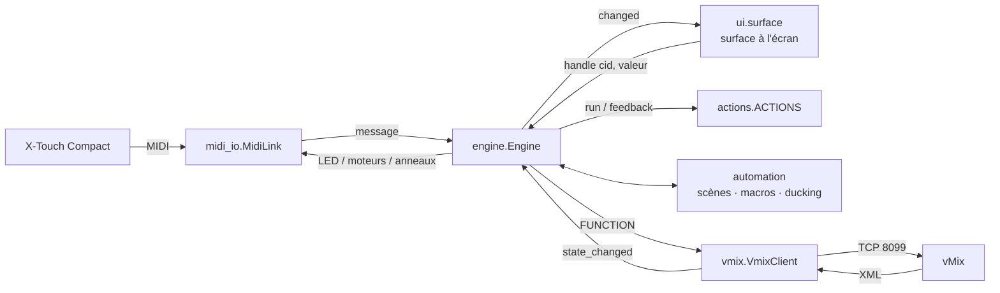

# 🧱 Architecture

← [Retour au README](../README.md)

MixPanel est une application **PySide6 (Qt)**. Le moteur est indépendant de l'interface : il reçoit des
valeurs de contrôles (de la X-Touch ou de la surface à l'écran), exécute des actions vMix et calcule les
retours (LED, moteurs, anneaux).

## Flux de données



## Modules

| Module | Rôle |
|---|---|
| `main.py` | Crée l'application, charge le dernier profil, relie MIDI, vMix, moteur et fenêtre |
| `pymixpanel/xtouch.py` | Description des 82 contrôles d'après la table MIDI officielle : message envoyé (TX), numéro de retour (RX : moteur, LED, anneau), tranche |
| `pymixpanel/midi_io.py` | Ouverture des ports par nom partiel et reconnexion automatique toutes les 2 s. Les messages arrivent par signal Qt |
| `pymixpanel/vmix.py` | Client TCP vMix à **deux connexions** : commandes (file avec fusion) et état (XML lu toutes les 100 ms et juste après chaque bouton). Analyse du XML en `VmixState` |
| `pymixpanel/actions.py` | Catalogue déclaratif des actions : paramètres, commande(s) vMix à envoyer, retour à lire dans l'état, libellé affiché sur la surface |
| `pymixpanel/engine.py` | Cœur de l'app : routage MIDI, apprentissage, protection des moteurs, encodeurs crantés, calcul des retours, glisser-déposer, sources retrouvées par leur nom |
| `pymixpanel/automation.py` | `SceneBook` (capture, rappel, correspondance), `MacroRunner` (étapes et pauses planifiées), `Ducker` (détection de parole, baisse et remontée) |
| `pymixpanel/importer.py` | Conversion d'un show Central Control `.ctrl` en profil |
| `pymixpanel/config.py` | `Profile` (dataclass) ⇄ JSON dans `%APPDATA%\MixPanel\profiles`, plus `settings.json` (dernier profil ouvert) et migration des anciens emplacements |
| `pymixpanel/ui/` | Fenêtre, surface dessinée à la main (`surface.py`), inspecteur, panneau de gauche, formulaires de paramètres partagés, éditeur de macros, réglages, thème |

## Choix techniques

### Latence

- **Fusion des commandes continues** : chaque fader a une clé (`vol:<source>`). Si une nouvelle valeur
  arrive avant l'envoi de la précédente, elle la remplace. vMix ne reçoit jamais une file de valeurs en retard.
- **IPv4 forcé** : sous Windows, `localhost` tente d'abord `::1`. vMix n'écoutant qu'en IPv4, chaque
  connexion perdait environ 2 s. `localhost` est donc résolu en `127.0.0.1`.
- **Lecture XML limitée** : jamais plus de ~25 lectures par seconde. Les mouvements de fader ne déclenchent
  pas de relecture : seuls les boutons le font, pour un retour LED immédiat.
- **Rafraîchissement de la surface** : l'animation n'est jamais relancée par un flux MIDI rapide (le minuteur
  n'est démarré que s'il est arrêté). Un fader manipulé est affiché sans lissage.

### Retours

`Engine.refresh_feedback()` parcourt tous les contrôles à chaque nouvel état vMix, calcule la valeur
attendue et n'envoie à la console **que ce qui a changé** (cache `_sent`).

### Ajouter une action

Toutes les actions sont déclarées dans `actions.py` :

```python
_add(Action(
    "multicorder", "Démarrer / arrêter le MultiCorder", PROD, False, [],  # clé, libellé, catégorie, continue ?, paramètres
    lambda p, v, st: [("StartStopMultiCorder", {}, None)],               # commande(s) vMix
    None,                                                                 # état de la LED (None = suit l'appui)
    lambda p, t: ("MULTI", "REC"),                                        # libellé sur la surface
    "Enregistrement multipiste de vMix.",                                 # aide
))
```

L'action apparaît automatiquement dans l'inspecteur et dans l'éditeur de macros, avec un formulaire généré à
partir de ses `Param`.

## Format d'un profil

```json
{
  "name": "Mon show",
  "vmix_host": "localhost", "vmix_port": 8099, "poll_ms": 100,
  "midi_in": "X-TOUCH COMPACT", "midi_out": "X-TOUCH COMPACT",
  "mappings": {
    "fader1": {"action": "volume", "input": "a81d47c9-…", "input_title": "Micro Animateur"},
    "push9":  {"action": "transition", "effect": "Cube", "duration": 500}
  },
  "scenes":  [{"id": "…", "name": "Jeu", "fade_ms": 0, "inputs": {"…": {"volume": 80, "muted": false, "buses": ["M", "A"]}}}],
  "macros":  [{"id": "…", "name": "Fin de stream", "steps": [{"action": "audio_off", "input": "…"}, {"action": "wait", "ms": 3000}]}],
  "ducking": {"enabled": false, "triggers": [], "targets": [], "threshold_db": -38, "depth": 30},
  "midi_overrides": {"enc1": {"midi": {"type": "cc", "ch": 0, "num": 60}}}
}
```

## Tests

`tests/test_core.py` démarre le faux vMix (`tools/fake_vmix.py`) sur le port 8199 et une fausse X-Touch,
puis vérifie de bout en bout :

| Test | Vérifie |
|---|---|
| `test_import_central_control` | Import du show Central Control fourni (`tests/fixtures`) |
| `test_fader_and_feedback` | Fader → volume, retour moteur, mute + LED, routage bus, transition |
| `test_touch_protection` | Le moteur ne bouge pas sous le doigt, puis suit au relâchement |
| `test_fast_fader_sweep_has_no_lag` | 250 messages/s arrivent tous, dernière valeur en < 150 ms |
| `test_encoder_rotation_and_push` | Double fonction, encodeur cranté et recentrage, choix d'effet |
| `test_relink_by_title` | Source recréée retrouvée par son nom |
| `test_scene_capture_and_recall` | Capture, LED de correspondance, rappel complet |
| `test_macro_steps_and_wait` | Ordre des étapes, pause respectée, LED pendant l'exécution |
| `test_ducking` | Baisse, remontée, niveau changé à la main conservé |
| `test_ring_meter` | Anneau LED piloté par le niveau audio (CC 26-41, valeurs 0-13) |
| `test_feedback_uses_official_rx_map` | Retours sur le canal global, notes LED 0-38, mode des anneaux, Layer A |
| `test_relative_encoder_no_jump` | Encodeur relatif : il part du niveau vMix, pas de saut |
| `test_learn_fader_position_and_touch` | Apprentissage simultané de la position et du capteur tactile |
| `test_all_actions_use_real_vmix_functions` | Chaque action n'appelle que des fonctions vMix réelles (le faux vMix refuse les autres) |
| `test_layer_b_pages` | Page B : associations séparées, bascule depuis la console ou l'app |
| `test_led_reassert_after_press` | LED du bouton et du groupe transport renvoyées après un appui |
| `test_pedal_noise_and_diagnostic` | Bruit de pédale ignoré ; en diagnostic, rien ne part vers vMix |
| `test_ring_cursor_never_blinks` | Anneau en curseur fixe (1-13), même quand la source est coupée |
| `test_vmix_volume_scale` | Conversion amplitude XML ↔ position de fader (6.25 = 50 %, -24 dB) |
| `test_fader_coordination` | Souris → moteur, vMix → moteur à un pas près, rien sous le doigt |
| `test_bus_led_stays_lit` | LED d'envoi sur bus allumée et réaffirmée périodiquement, moteurs intacts |
| `test_no_motor_catch_up_at_bottom` | Pas de rattrapage moteur après un geste rapide qui finit en bas de course |
| `test_no_catch_up_with_slow_vmix` | vMix lent (volumes appliqués en retard) : pas de retour vers une valeur périmée |
| `test_lost_final_command_is_resent` | vMix perd la fin d'une rafale : la position du fader lui est renvoyée, le moteur ne « corrige » pas |
| `test_final_position_sent_twice` | Au relâchement après un geste, la position finale part deux fois vers vMix |
| `test_ring_shows_push_state` | Anneau témoin de l'appui : plein (27), éteint, clignotant (28), pendant l'appui pour une action sans état |
| `test_ducking_without_setvolumefade` | Ducking fonctionnel même si SetVolumeFade ne fait rien (fondu fait par MixPanel) |
| `test_console_mode_mc_and_back` | Mode Mackie : MixPanel en pause (ni actions, ni retours), puis retour au mode standard |
