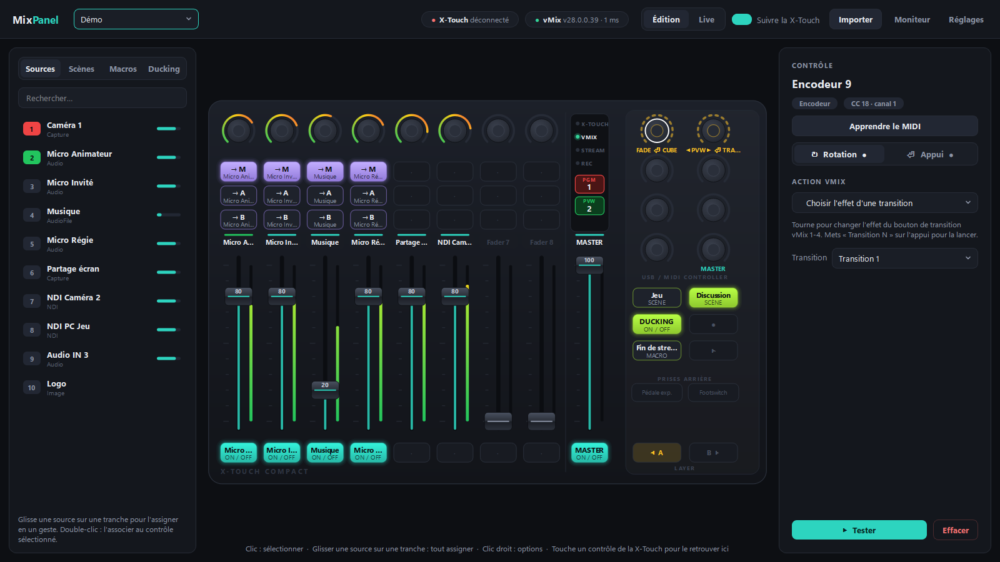
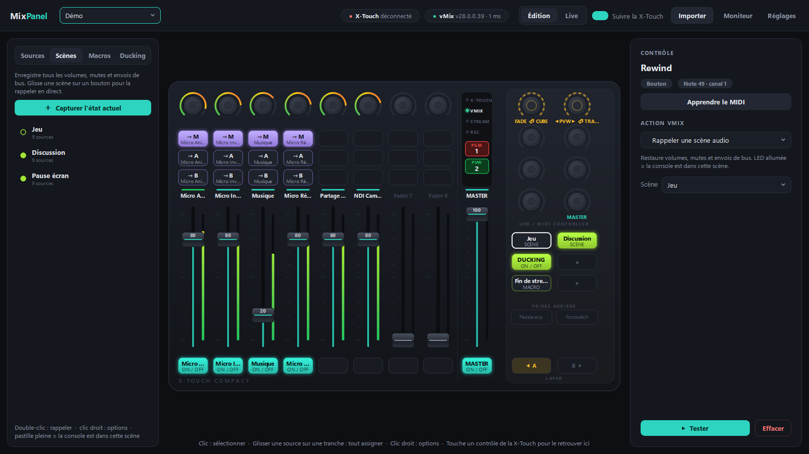
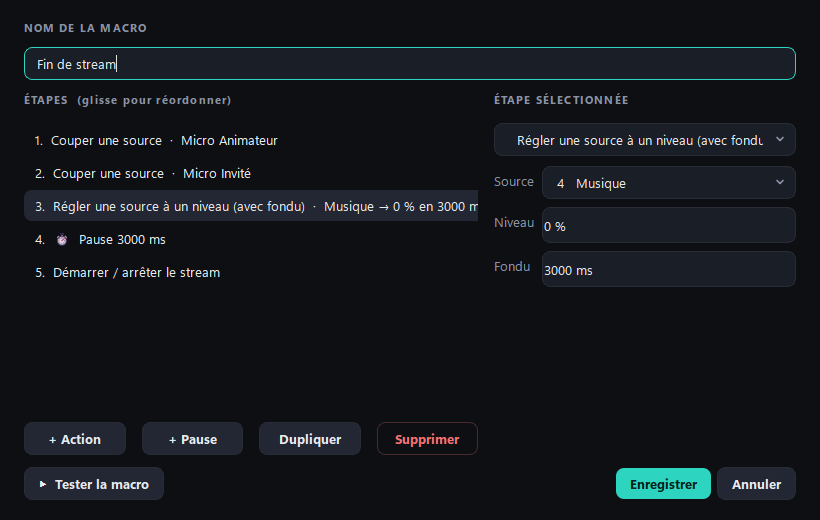
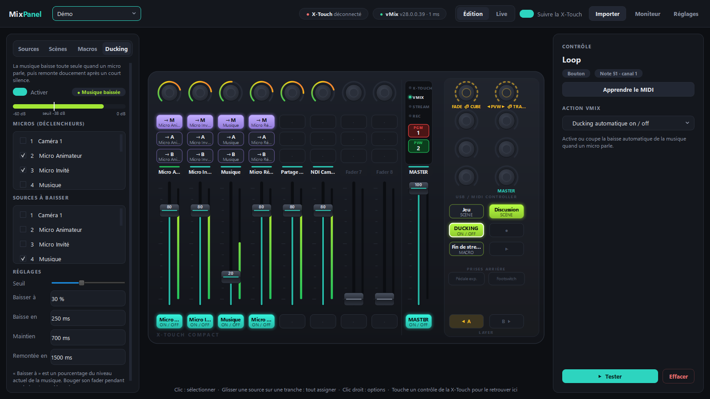
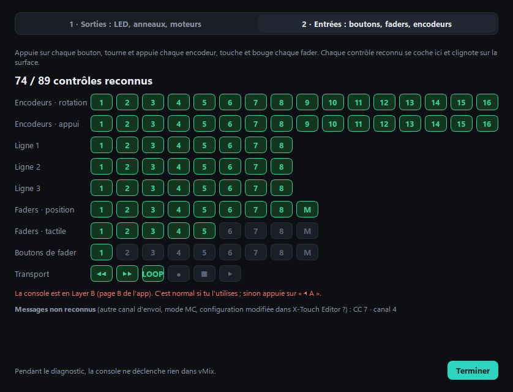

# 📘 Guide d'utilisation

← [Retour au README](../README.md)

- [1. Premier lancement](#1-premier-lancement)
- [2. L'interface](#2-linterface)
- [3. Associer un contrôle](#3-associer-un-contrôle)
- [4. Les encodeurs](#4-les-encodeurs)
- [5. Scènes audio](#5-scènes-audio)
- [6. Macros](#6-macros)
- [7. Ducking automatique](#7-ducking-automatique)
- [8. Anneaux LED en vu-mètre](#8-anneaux-led-en-vu-mètre)
- [8 bis. Pages A / B (Layer)](#8-bis-pages-a--b-layer)
- [8 ter. Diagnostic de la console](#8-ter-diagnostic-de-la-console)
- [9. Profils et import Central Control](#9-profils-et-import-central-control)
- [10. Réglages](#10-réglages)
- [11. Catalogue des actions](#11-catalogue-des-actions)
- [12. Dépannage](#12-dépannage)

---

## 1. Premier lancement

1. Branche la X-Touch Compact en USB et laisse-la en **mode MIDI standard** (réglage d'usine).
2. Lance vMix. Son API TCP écoute sur le port **8099** par défaut, sans rien à configurer.
3. **Ferme Central Control** s'il tourne encore.
4. Lance `MixPanel.bat` (ou `python main.py`).
5. Ouvre **Réglages → Canal global → Détecter…** pour que les moteurs et les LED répondent, puis
   **Diagnostic** pour tout vérifier en une minute.

En haut à droite, deux pastilles indiquent l'état des connexions :

| Pastille | Signification |
|---|---|
| 🟢 **X-Touch** `X-TOUCH COMPACT` | Console détectée |
| 🟢 **vMix** `v28… · 2 ms` | vMix connecté, avec la latence moyenne d'une commande |
| 🔴 **déconnecté** | L'app réessaie toute seule toutes les 2 secondes |

## 2. L'interface

| Zone | Rôle |
|---|---|
| **En-tête** | Profil actif, état des connexions, mode Édition / Live, *Suivre la X-Touch*, Import, Moniteur, Réglages |
| **Gauche** | Onglets **Sources** (entrées vMix en direct), **Scènes**, **Macros**, **Ducking** |
| **Centre** | La X-Touch à l'écran : 8 tranches, la colonne MAIN (LED d'état, PGM/PVW) et le bloc de droite (8 encodeurs, transport, LAYER) |
| **Droite** | L'inspecteur du contrôle sélectionné : son identifiant MIDI, l'action, les paramètres et le bouton Tester |

### Ce que la surface affiche

- **Couleur d'un contrôle** = catégorie de son action : 🟢 audio, 🟣 bus, 🟡 vidéo, 🔴 production, 🟩 scènes et macros, 🔵 avancé.
- **Bouton plein** = LED allumée (source active, envoyée sur le bus, scène en cours…).
- **Barre au-dessus du fader** : 🔴 la source est au programme, 🟢 en preview.
- **Vu-mètre** à droite de chaque fader, de -60 à 0 dB.
- **Pastille rouge** : la source associée est introuvable dans vMix.

### Modes Édition et Live

- **Édition** : cliquer un bouton le sélectionne pour l'éditer.
- **Live** : cliquer un bouton l'actionne, comme sur la console. C'est pratique pour tester sans la X-Touch.

Les faders et les encodeurs se manipulent à la souris (glisser) ou à la molette dans les deux modes.

### Verrouiller pendant un direct

Le bouton **Verrouiller** (ou **Ctrl+L**) de l'en-tête évite les fausses manips en plein direct. Une fois activé :

- l'édition est bloquée : inspecteur, bibliothèque, glisser-déposer, clic droit, apprentissage MIDI, import, profils, réglages et diagnostic sont grisés ;
- les clics à l'écran n'envoient plus rien à vMix (boutons, faders, encodeurs, bascule Layer A / B) ;
- **la X-Touch continue de fonctionner normalement**.

Le verrou est mémorisé : si tu relances MixPanel en plein direct, il reste actif. Pour le lever, il faut confirmer ; quitter l'application verrouillée demande aussi une confirmation.

## 3. Associer un contrôle

### Une tranche entière, en un geste

Glisse une source depuis l'onglet **Sources** sur n'importe quelle partie d'une tranche :

| Contrôle | Action assignée |
|---|---|
| Fader | Volume de la source |
| Bouton sous le fader | Activer / couper la source |
| Ligne de boutons 1 / 2 / 3 | Envoi vers Master / Bus A / Bus B |

Les bus des 3 lignes se changent dans **Réglages → Modèle de tranche**.

### Un contrôle précis

1. Sélectionne-le : clic sur la surface, ou **touche-le sur la X-Touch** si *Suivre la X-Touch* est activé.
2. Choisis l'**action** dans l'inspecteur. Si le contrôle est sur une tranche déjà assignée, la source est pré-remplie.
3. Règle les paramètres. Tout est enregistré immédiatement.
4. **▶ Tester** déclenche l'action sans toucher la console.

| Raccourci | Effet |
|---|---|
| Double-clic sur une source | L'associe au contrôle sélectionné |
| Glisser une scène ou une macro sur un bouton | Rappel de la scène / lancement de la macro |
| `Suppr` | Efface l'association du contrôle sélectionné |
| `Échap` | Annule l'apprentissage MIDI, ou désélectionne |
| Clic droit | Apprendre le MIDI, Tester, Effacer, assigner ou vider la tranche |

### Volume : l'échelle de vMix

Les faders de MixPanel suivent exactement le fader de vMix : **0 dB en haut, -24 dB à mi-course, -∞ tout en bas**.
Le curseur affiche la valeur en dB. (vMix commande le volume en *position de fader*, mais publie dans son état un
niveau d'amplitude : MixPanel convertit l'un dans l'autre, `amplitude = (position / 100)⁴`.)

## 4. Les encodeurs

Chaque encodeur a **deux fonctions indépendantes** : la **rotation** et l'**appui**. Dans l'inspecteur,
les onglets **↻ Rotation | ⏎ Appui** basculent de l'une à l'autre. Un point « ● » signale celle qui est déjà
associée. Sur la surface, la rotation est indiquée sous l'encodeur et l'appui est préfixé par ⏎.

Il y a deux façons de tourner :

- **Continue** (volume, balance, gain, volume d'un bus…) : l'anneau LED montre la valeur.
- **Crantée** (anneau en pointillés) : chaque cran fait une action. L'encodeur est recentré à chaque cran, il ne bute donc jamais.
  - *Parcourir les sources en preview*
  - *Choisir l'effet d'une transition* (1 à 4)
  - *Régler la durée d'une transition* (±100 ms par cran)

**Anneau LED** (sous les onglets Rotation / Appui) : les appuis d'encodeur n'ont pas de LED, l'anneau peut
donc servir de témoin.

| Réglage | L'anneau affiche |
|---|---|
| Auto | le curseur si une rotation est associée, sinon l'état de l'appui |
| Curseur | le niveau de la rotation (une LED) |
| État de l'appui : plein | tout l'anneau allumé quand l'action de l'appui est active, éteint sinon |
| État de l'appui : clignotant | tout l'anneau clignote quand l'action est active |
| Éteint | rien |

Une action sans état (transition, fonction personnalisée…) allume l'anneau pendant l'appui.

> 💡 Combinaison efficace : **rotation** = *Parcourir les sources en preview*, **appui** = *Transition principale* → `Transition1`.
> Tu choisis la prochaine caméra en tournant, et tu l'envoies en appuyant.

## 5. Scènes audio

Une scène est un **instantané de tout le mixeur** : volume, mute et envois de bus de chaque source,
plus le Master et les bus.

1. Règle ta console comme tu veux, puis clique **＋ Capturer l'état actuel**.
2. **Glisse la scène sur un bouton** de la X-Touch.
3. En live, appuie sur le bouton pour tout restaurer.

- La **LED du bouton reste allumée** tant que la console correspond à la scène. Elle s'éteint dès que tu changes quelque chose.
- **Clic droit sur une scène** : rappeler, mettre à jour avec l'état actuel, renommer, régler un **fondu au rappel** (les volumes glissent au lieu de sauter), supprimer.
- L'action *Enregistrer l'état dans une scène* permet aussi de mettre une scène à jour depuis un bouton.

## 6. Macros

Une macro **enchaîne plusieurs actions** sur un seul bouton.

1. Onglet **Macros** → **＋ Nouvelle macro**.
2. Ajoute des étapes avec **+ Action**, et des **+ Pause** pour retarder la suite. Glisse les étapes pour les réordonner.
3. **▶ Tester la macro**, puis **Enregistrer**.
4. Glisse la macro sur un bouton. Sa LED est allumée pendant l'exécution.

Exemple « Fin de stream » :

| # | Étape |
|---|---|
| 1 | Couper une source · Micro Animateur |
| 2 | Couper une source · Micro Invité |
| 3 | Régler une source à un niveau · Musique → 0 % en 3000 ms |
| 4 | ⏱ Pause 3000 ms |
| 5 | Démarrer / arrêter le stream |

> 💡 Dans une macro, préfère *Activer une source* / *Couper une source* à *Activer / couper* :
> le résultat est toujours le même, quel que soit l'état de départ.

Une macro peut rappeler une scène ou lancer une autre macro. L'imbrication est limitée à 4 niveaux pour éviter les boucles.

## 7. Ducking automatique

Le ducking **baisse la musique quand quelqu'un parle**, puis la remonte après un court silence.
Il est **désactivé par défaut**.

1. Onglet **Ducking** : coche les **micros** qui déclenchent et les **sources à baisser**.
2. Parle dans le micro et observe la barre de niveau. Place le **seuil** juste au-dessus du bruit de fond.
3. Active le ducking avec l'interrupteur, ou depuis un bouton avec l'action *Ducking automatique on / off*.

| Réglage | Rôle | Défaut |
|---|---|---|
| Seuil | Niveau du micro au-dessus duquel on considère que quelqu'un parle | -38 dB |
| Baisser de | Baisse de la musique pendant la parole, par rapport à son niveau actuel | -12 dB |
| Baisse en | Durée du fondu de baisse | 250 ms |
| Maintien | Silence nécessaire avant de remonter (évite le « pompage » entre deux phrases) | 700 ms |
| Remontée en | Durée du fondu de remontée | 1500 ms |

**Le ducking te laisse la main :** si tu bouges le fader de la musique pendant une baisse, ou si tu changes
son volume dans vMix, ton nouveau niveau est gardé et la remontée ne l'écrase pas. Si tu fermes l'app
pendant une baisse, la musique remonte.

## 8. Anneaux LED en vu-mètre

Deux possibilités :

- **Action dédiée** : sur n'importe quel encodeur (rotation), choisis *Vu-mètre sur l'anneau LED* et la
  source : Master, un bus ou une source. Idéal sur un encodeur du bloc de droite pour surveiller le Master.
- **Automatique** : dans **Réglages**, coche *Encodeurs libres des tranches = vu-mètre de la source*.
  Chaque encodeur de tranche **sans action de rotation** affiche alors le niveau de la source de son fader.

À distance, la console n'allume qu'une LED par anneau : le niveau (ou le vu-mètre) s'affiche comme un **curseur**
qui se déplace sur l'anneau.

## 8 bis. Pages A / B (Layer)

Les boutons **◀ A** et **B ▶** de la console changent de couche : en Layer B, chaque contrôle envoie d'autres
messages. MixPanel en fait **deux pages d'associations indépendantes**, soit 16 tranches au total.

- Appuie sur **B ▶** sur la console : l'app passe d'elle-même en page B, et les LED, moteurs et anneaux affichent la page B.
- Ou clique **◀ A** / **B ▶** sur la surface à l'écran : la console bascule aussi.
- La page affichée apparaît dans l'inspecteur (« Bouton · page B »). Glisser une source, assigner une tranche,
  scènes et macros fonctionnent de la même façon sur les deux pages.

## 8 ter. Diagnostic de la console

**Diagnostic** (en-tête) vérifie en une minute que la console et l'app se comprennent. Pendant le diagnostic,
la console ne déclenche rien dans vMix.

1. **Sorties** : *Lancer la démonstration* allume les LED rangée par rangée, remplit les anneaux et fait
   monter puis descendre les faders. Tout doit se produire au bon endroit.
2. **Entrées** : appuie, tourne et bouge chaque contrôle. Il se coche dans la grille et clignote sur la surface.
   Les messages inattendus (autre canal, mode MC, Layer B…) sont listés en dessous.
3. **Rafraîchissement** : mesures en direct (aller-retour des commandes vMix, durée et fréquence des lectures d'état,
   messages MIDI par seconde), avec des conseils si vMix est trop lent.

## 9. Profils et import Central Control

- Un **profil** regroupe les associations, les scènes, les macros, le ducking et les réglages. Ce sont des fichiers JSON
  dans **`%APPDATA%\MixPanel\profiles`** (**Réglages → Profils → Ouvrir**). Ils survivent aux mises à jour :
  relance simplement le nouvel installateur.
- La liste déroulante de l'en-tête bascule d'un profil à l'autre. **＋ Nouveau profil…** crée un profil vide.
- **Importer** accepte un show Central Control (`.ctrl`) ou un profil MixPanel (`.json`).
  L'import reprend les connexions vMix et MIDI et toutes les associations reconnues, puis affiche un récapitulatif de ce qui n'a pas pu être repris.

Les sources sont mémorisées par leur **clé vMix** et par leur **nom**. Si tu recharges un autre preset vMix
où la source a été recréée, MixPanel la retrouve par son nom et met le profil à jour.

## 10. Réglages

| Réglage | Description |
|---|---|
| Adresse / Port | vMix local (`localhost`) ou distant (`192.168.x.x`), port TCP 8099 |
| Rafraîchissement | Fréquence de lecture de l'état vMix (100 ms recommandé) |
| Entrée / Sortie MIDI | Une partie du nom suffit (`X-TOUCH`) : la console est retrouvée même si Windows change son numéro |
| Canal global | Canal sur lequel la X-Touch écoute les retours (moteurs, LED, anneaux). **Détecter…** le trouve pour toi |
| LED des boutons | *Firmware récent* (2 = allumée, 3 = clignote) ou *Manuel Behringer* (1 / 2) |
| Mode de la console | *Mode standard* (MixPanel) ou *Mode Mackie (MC)…* pour piloter un autre logiciel ; MixPanel se met alors en pause. Option : remettre le mode standard au lancement |
| Protection fader | Délai pendant lequel le moteur ne suit pas vMix après un mouvement manuel |
| Anneaux LED | Encodeurs libres = vu-mètre de leur tranche |
| Modèle de tranche | Bus affectés aux 3 lignes de boutons quand on glisse une source sur une tranche |

## 11. Catalogue des actions

<b>Audio</b>

| Action | Contrôle | Commande vMix | LED / position |
|---|---|---|---|
| Volume d'une source | Fader, encodeur | `SetVolume` | Volume |
| Volume Master | Fader, encodeur | `SetMasterVolume` | Volume |
| Volume d'un bus | Fader, encodeur | `SetBus{X}Volume` | Volume |
| Volume casque | Fader, encodeur | `SetHeadphonesVolume` | Volume |
| Balance d'une source | Encodeur | `SetBalance` | Balance |
| Gain d'une source (0-24 dB) | Encodeur | `SetGain` | Gain |
| Vu-mètre sur l'anneau LED | Encodeur | – | Niveau audio |
| Activer / couper une source | Bouton | `Audio` | Allumée = audible |
| Activer une source / Couper une source | Bouton | `AudioOn` / `AudioOff` | État |
| Régler une source à un niveau (avec fondu) | Bouton | `SetVolume` pas à pas (fondu fait par MixPanel) | Allumée = au niveau |
| Activer / couper le Master | Bouton | `MasterAudio` | Allumée = actif |
| Activer / couper un bus | Bouton | `BusXAudio` | Allumée = actif |

<b>Bus</b>

| Action | Commande vMix | LED |
|---|---|---|
| Envoyer une source vers un bus (M, A–G) | `AudioBus` | Allumée = envoyée |

<b>Vidéo</b>

| Action | Contrôle | Commande vMix | LED |
|---|---|---|---|
| Transition principale (Cut, Fade, Cube, Stinger, Transition1-4…) | Bouton | `<Effet> Duration=` | – |
| Mettre une source en preview | Bouton | `PreviewInput` | Allumée = en preview |
| Passer une source au programme (cut) | Bouton | `CutDirect` | Allumée = au programme |
| Fondu vers une source | Bouton | `Fade` | Allumée = au programme |
| Overlay 1-4 | Bouton | `OverlayInput{N}` | Allumée = affiché |
| Parcourir les sources en preview | Encodeur cranté | `PreviewInputNext/Previous` | – |
| Choisir l'effet d'une transition | Encodeur cranté | `SetTransitionEffect{N}` | – |
| Régler la durée d'une transition | Encodeur cranté | `SetTransitionDuration{N}` | – |

<b>Production</b>

| Action | Commande vMix | LED |
|---|---|---|
| Démarrer / arrêter le stream | `StartStopStreaming` | Allumée = en direct |
| Démarrer / arrêter l'enregistrement | `StartStopRecording` | Allumée = enregistre |
| Sortie externe on / off | `StartStopExternal` | Allumée = active |
| Fondu au noir | `FadeToBlack` | Allumée = au noir |

<b>Scènes & macros</b>

| Action | LED |
|---|---|
| Rappeler une scène audio | Allumée = la console est dans la scène |
| Enregistrer l'état dans une scène | Suit l'appui |
| Lancer une macro | Allumée pendant l'exécution |
| Ducking automatique on / off | Allumée = activé |

<b>Avancé</b>

| Action | Description |
|---|---|
| Fonction vMix personnalisée | N'importe quelle [fonction de l'API vMix](https://www.vmix.com/help28/ShortcutFunctionReference.html), avec des paramètres au format `Input=3&Value=50` |
| Fonction vMix continue personnalisée | Idem pour un fader ou un encodeur : `{value}` est remplacé par la position (0-100) |

## 12. Dépannage

<b>La pastille X-Touch reste rouge</b>

- Central Control, ou un autre logiciel MIDI, occupe encore le port : ferme-le.
- Vérifie que le nom indiqué dans **Réglages → Entrée MIDI** correspond à la liste proposée.
- Débranche puis rebranche la console : la reconnexion est automatique.

<b>La pastille vMix reste rouge</b>

- vMix doit être lancé. L'API TCP (port 8099) est active par défaut.
- Si vMix tourne sur un autre PC, mets son adresse IP dans **Réglages** et autorise le port 8099 dans le pare-feu.

<b>Un contrôle ne réagit pas, ou c'est le mauvais qui réagit</b>

Ouvre le **Moniteur** et bouge le contrôle. Une ligne `MIDI non associé : CC 42 · canal 1` indique qu'il envoie
un autre message que prévu (autre canal, Layer B, mode MC…). Sélectionne le contrôle, clique
**Apprendre le MIDI**, puis bouge-le. **Par défaut** rétablit l'identifiant d'origine.

<b>La LED « MC » de la console est allumée et rien ne correspond</b>

La console est en mode Mackie Control, laissé par un autre logiciel. **Réglages → Mode de la console → Mode
standard**. Avec l'option *Remettre la console en mode standard au lancement*, MixPanel le fait tout seul au démarrage.

<b>Les boutons s'allument mais rien ne se passe dans vMix</b>

Corrigé en 1.0.3 : les versions précédentes utilisaient deux noms de fonctions vMix qui n'existent pas
(`AudioOnOff`, `AudioBusOnOff`). Mets à jour MixPanel. Si une commande est refusée, le **Moniteur** affiche une ligne
`vMix ✗`.

<b>Les faders ne suivent pas vMix, ou aucune LED ne s'allume</b>

Tous les retours partent sur le **canal global** de la console. S'il ne correspond pas, la X-Touch ignore tout.
Ouvre **Réglages → Canal global → Détecter…** : le fader 1 et la première ligne de LED bougent canal par canal.
Clique **Il bouge !** au bon moment.

<b>Les LED n'affichent pas l'état, ou clignotent au lieu de rester allumées</b>

Selon le firmware, la X-Touch interprète différemment la vélocité des notes : dans **Réglages → LED des boutons**,
essaie *Manuel Behringer* au lieu de *Firmware récent*. Pour vérifier ce qui part vers la console : **Moniteur**,
puis coche *Afficher aussi les messages envoyés à la X-Touch*.

<b>Un fader motorisé « lutte » ou saute</b>

Depuis la 1.0.5, l'échelle de volume de vMix est respectée (voir plus bas), ce qui supprimait l'essentiel des sauts.
S'il en reste, augmente **Réglages → Protection fader** (par exemple 500 ms). Si le capteur tactile n'est pas reconnu, apprends-le :
sélectionne le fader, clique **Apprendre le MIDI**, pose le doigt sur le fader et bouge-le.

<b>Une commande est refusée par vMix</b>

Le Moniteur affiche `vMix ✗ <fonction> → <message>`. Vérifie le nom de la fonction (actions personnalisées)
et ta version de vMix. Certaines fonctions récentes n'existent pas dans les anciennes versions.

