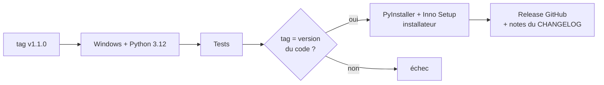

# 🚀 Publier une version

← [Retour au README](../README.md)

Une release = un **installateur Windows** compilé automatiquement par GitHub Actions et publié dans
[Releases](https://github.com/lfpoulain/py-mix-panel/releases).

## En résumé

1. Décris les changements dans **`CHANGELOG.md`** sous un nouveau titre `## 1.1.0 — AAAA-MM-JJ`, puis commite.
2. Lance :

   ```bash
   python tools/release.py 1.1.0
   ```

3. Quelques minutes plus tard, la release **MixPanel 1.1.0** apparaît avec son installateur `MixPanel-1.1.0-setup.exe`
   et les notes tirées du CHANGELOG.

## Ce que fait `tools/release.py`

| Étape | Détail |
|---|---|
| Vérifications | Dépôt propre, tag inexistant, section `## 1.1.0` présente dans le CHANGELOG |
| Tests | `tests/test_core.py` doit passer, sinon rien n'est publié |
| Version | Met à jour `pymixpanel/__init__.py` et commite « Version 1.1.0 » |
| Tag | Crée le tag annoté `v1.1.0` et pousse le commit et le tag |

Avec `--dry-run`, le script fait toutes les vérifications sans rien modifier.

## Ce que fait GitHub Actions

Le workflow [`release.yml`](../.github/workflows/release.yml) se déclenche sur chaque tag `vX.Y.Z` :



- L'installateur est aussi conservé en **artefact** du workflow.
- Lancé à la main (onglet **Actions → Release → Run workflow**), le workflow compile sans publier : pratique pour
  tester un build.
- Le workflow [`tests.yml`](../.github/workflows/tests.yml) lance le lint et les tests à chaque push sur `main`.

## Compiler l'installateur sur ton PC

Il faut [Inno Setup 6](https://jrsoftware.org/isdl.php) (déjà présent sur les runners GitHub).

```bash
pip install -r requirements-build.txt
```

```bash
python tools/build_exe.py
```

Le fichier `MixPanel-x.y.z-setup.exe` arrive dans `dist/` (`--no-installer` s'arrête au dossier `dist/MixPanel/`). La compilation :

- génère l'icône (dessinée par l'app elle-même, en toutes tailles) ;
- renseigne les métadonnées Windows de l'exe (version, description), visibles dans les propriétés du fichier ;
- produit l'app **sans console** en dossier, avec Qt, le pilote MIDI (`python-rtmidi`) et les ressources de l'interface, puis l'emballe dans un installateur par utilisateur (sans droits administrateur).

## Données personnelles

L'app range sa configuration dans `%APPDATA%\MixPanel` (variable `MIXPANEL_HOME` pour choisir un autre dossier),
que tu la lances en exe ou depuis les sources. Rien n'est écrit dans le dépôt, et `profiles/`, `settings.json` et
les fichiers `.ctrl` sont de toute façon exclus par `.gitignore` : tes shows restent sur ton PC.
Les tests et les captures utilisent un show de démonstration (`tests/fixtures/demo-show.ctrl`) et des sources fictives
(`tools/fake_vmix.py`).
